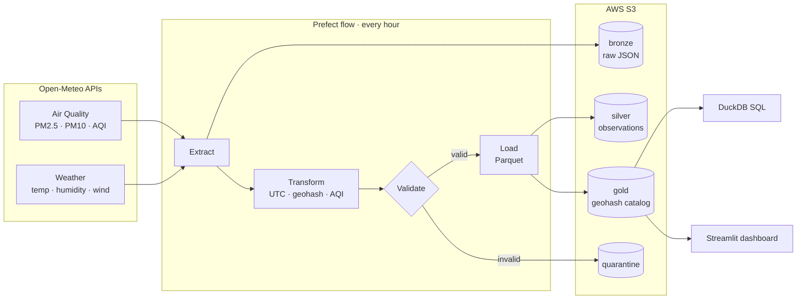

<div align="center">

# SmogWatch PK

**An hourly data pipeline that builds a geospatial air-quality catalog for Pakistan's cities.**

Prefect · AWS S3 · Parquet · Pandas · Pandera · DuckDB · GitHub Actions

[](https://github.com/SyedAshherMajid/smogwatch-pk/actions/workflows/ci.yml)


[](LICENSE)

</div>

---

> **🚧 Status: in active development.** The architecture, tooling, and CI are in place; pipeline
> stages are being built phase by phase. See the [roadmap](#roadmap) for what's done and what's next.

## Why

Every winter, smog pushes PM2.5 levels in Lahore and across Punjab many times above safe limits.
Schools close, flights are delayed, and hospitals fill up. The data is out there but scattered.
There's no clean, queryable history that can answer simple questions like:

- *Which parts of Lahore had the worst air in the last 7 days?*
- *Does low wind speed line up with smog spikes?*
- *How many hours this month was Karachi "Unhealthy" compared to Lahore?*

**SmogWatch PK** collects air-quality and weather data every hour, organises it into geographic
cells using **geohashes**, validates it, and stores it as a partitioned Parquet catalog in **AWS S3**,
so each of those questions becomes a single SQL query.

## What it does

| | |
|---|---|
| ⏱️ **Hourly ingestion** | Pulls air quality (PM2.5, PM10, AQI, NO₂, O₃) and weather (temperature, humidity, wind) for ~100 points across 10 cities |
| 🗺️ **Geohash catalogs** | Tags every point with a geohash and aggregates per cell per hour (precision 5 ≈ 5 km, precision 4 rollup) |
| ✅ **Data validation** | Row-level schemas (Pandera) and run-level checks (completeness, freshness, duplicates); bad rows go to a quarantine with the reason |
| 🔁 **Idempotent & self-healing** | Deterministic hourly partitions: re-runs overwrite instead of duplicating; each run refreshes the last 3 hours; backfill flow for longer gaps |
| 🪣 **Bronze / silver / gold on S3** | Raw responses kept for replay; clean observations; query-ready catalogs |
| 🔎 **SQL analytics** | DuckDB queries directly over Parquet on S3 |
| 🔐 **Keyless cloud auth** | GitHub Actions → AWS via OIDC with a least-privilege IAM role, so no stored access keys |
| 📊 **Dashboard** | Streamlit map of AQI by geohash cell, city trends, and pipeline health |

## Architecture



**Scheduling:** GitHub Actions cron (minute 7 of every hour) runs the Prefect flow. The job
authenticates to AWS through OIDC, and every run is visible in Prefect Cloud.

Full design, S3 layout, and failure handling: **[docs/architecture.md](docs/architecture.md)**

### S3 layout

```
s3://<bucket>/
├── bronze/source=air_quality/date=2026-11-20/hour=14/response.json.gz
├── silver/observations/date=2026-11-20/hour=14/part-0.parquet
├── gold/catalog_p5/date=2026-11-20/hour=14/part-0.parquet
├── gold/latest/catalog_p5.parquet
├── quarantine/date=2026-11-20/hour=14/rejected.parquet
└── manifests/date=2026-11-20/hour=14/run-<run_id>.json
```

Hive-style `date=/hour=` partitions let query engines skip irrelevant data, and fixed file names make
every write idempotent.

## Tech stack

| Area | Tools |
|------|-------|
| Language & env | Python 3.12, uv (locked dependencies), poethepoet |
| Orchestration | Prefect 3, Prefect Cloud (free tier) |
| Processing | Pandas, PyArrow |
| Validation | Pandera |
| Geospatial | Geohash (own implementation, tested against `pygeohash`) |
| Storage | AWS S3 (prod), MinIO (local), Parquet |
| Query | DuckDB |
| Dashboard | Streamlit |
| Quality | pytest, coverage, ruff, mypy, pre-commit, gitleaks |
| CI/CD | GitHub Actions, Dependabot |
| Cloud security | IAM least privilege, GitHub OIDC, AWS Budgets |

## Data

- **Source:** [Open-Meteo](https://open-meteo.com/) Air Quality and Forecast APIs (free, no API key).
- **Coverage:** Lahore, Karachi, Islamabad–Rawalpindi, Faisalabad, Gujranwala, Sialkot, Multan,
  Peshawar, Quetta, Hyderabad.
- **Honest note:** air-quality values are **modelled** (Copernicus CAMS), not readings from physical
  ground sensors. The model's resolution is coarse, so neighbouring points can show similar values.
  The pipeline is built so a sensor-based source could be added alongside it.

Schema and quality rules: **[docs/data-dictionary.md](docs/data-dictionary.md)**

## Project structure

```
smogwatch-pk/
├── src/smogwatch/
│   ├── extract/        # Open-Meteo client
│   ├── transform/      # clean, AQI, geohash catalogs (pure functions, no I/O)
│   ├── validate/       # Pandera schemas + run-level checks
│   ├── load/           # S3 paths + storage (MinIO / AWS)
│   ├── geo/            # grid generation + geohash
│   ├── flows/          # Prefect flows: hourly, backfill, freshness
│   ├── settings.py     # typed config from environment
│   └── manifest.py     # per-run summary + quality report
├── config/             # cities and grid definition
├── sql/                # analytics queries
├── dashboard/          # Streamlit app
├── tests/              # unit + integration tests
├── infra/              # IAM policies (Terraform later)
├── docs/               # architecture, data dictionary, runbook, ADRs
└── .github/            # CI, Dependabot, templates
```

## Getting started

**Prerequisites:** [uv](https://docs.astral.sh/uv/), Git. Docker is needed later for local MinIO and Prefect.

```bash
git clone https://github.com/SyedAshherMajid/smogwatch-pk.git
cd smogwatch-pk
uv sync                          # creates .venv with Python 3.12 + locked dependencies
uv run pre-commit install        # enable pre-commit hooks
uv run poe check                 # lint + format check + type check + tests
```

| Command | What it does |
|---------|--------------|
| `uv run poe lint` | Lint with ruff |
| `uv run poe fmt` | Auto-format with ruff |
| `uv run poe typecheck` | Type check with mypy |
| `uv run poe test` | Run tests with coverage |
| `uv run poe check` | All of the above (same as CI) |

## Roadmap

- [x] **Phase 1: Foundation:** repo structure, tooling, CI, docs, design decisions
- [ ] **Phase 2: Extract:** Open-Meteo client with batching, timeouts, and tests
- [ ] **Phase 3: Geo:** city grids and a geohash encoder (verified against a reference library)
- [ ] **Phase 4: Transform:** cleaning, UTC handling, AQI calculation, geohash catalogs
- [ ] **Phase 5: Validate:** Pandera schemas, run-level checks, quarantine, quality report
- [ ] **Phase 6: Storage:** MinIO locally, Parquet partitions, idempotent writes
- [ ] **Phase 7: Orchestration:** Prefect flows with retries, backfill
- [ ] **Phase 8: AWS:** S3 bucket, least-privilege IAM, OIDC, budget alerts
- [ ] **Phase 9: Production:** hourly schedule on GitHub Actions + Prefect Cloud
- [ ] **Phase 10: SQL analytics:** DuckDB queries with window functions
- [ ] **Phase 11: Dashboard:** Streamlit map + trends + pipeline health
- [ ] **Phase 12: Operations:** backfill workflow, freshness checks, weekly API smoke test
- [ ] **Phase 13: v1.0:** docs polish and release

**Possible extensions:** Terraform for AWS resources · Polars port + benchmark · comparison with
ground-sensor data (OpenAQ) · national grid using a country boundary polygon · self-hosted Prefect worker.

## Design decisions

| # | Decision |
|---|----------|
| [0001](docs/decisions/0001-prefect-over-airflow.md) | Prefect over Airflow / cron |
| [0002](docs/decisions/0002-parquet-hive-partitioning.md) | Parquet with Hive-style date/hour partitions |
| [0003](docs/decisions/0003-duckdb-over-postgres.md) | DuckDB over PostgreSQL for analytics |
| [0004](docs/decisions/0004-oidc-instead-of-access-keys.md) | GitHub OIDC instead of stored AWS keys |

## License

[MIT](LICENSE) © 2026 Syed Ashher Majid

---

<div align="center">
Built by <a href="https://github.com/SyedAshherMajid">Syed Ashher Majid</a> ·
<a href="https://ashher-portfolio.vercel.app">Portfolio</a> ·
<a href="https://linkedin.com/in/syed-ashher-majid-3a50b9319">LinkedIn</a>
</div>
