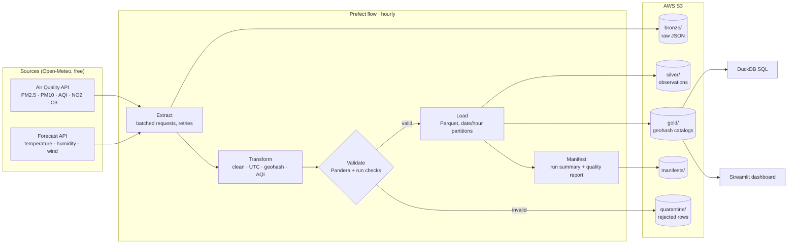
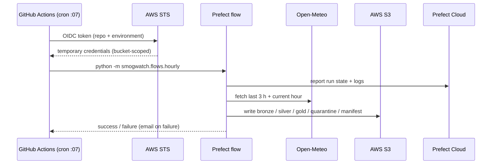

# Architecture

> Status: **design**. Components are being built phase by phase; see the roadmap in the README.

## Overview



## Layers (medallion pattern)

| Layer | Contents | Purpose |
|-------|----------|---------|
| Bronze | Raw API responses (gzipped JSON), untouched | Source of truth; lets us reprocess history after fixing a bug without re-calling the API |
| Silver | One row per point per hour; cleaned, typed, geohashed, validated | Trusted facts |
| Gold | One row per geohash cell per hour (precision 5, plus precision 4 rollup) | What people and dashboards query |
| Quarantine | Rows that failed validation, with the reason | Bad data never enters silver/gold silently, and is never thrown away |
| Manifests | One JSON per run | Observability: counts, timings, checks |

## Object layout

```
s3://<bucket>/
├── bronze/source=air_quality/date=YYYY-MM-DD/hour=HH/response.json.gz
├── bronze/source=weather/date=YYYY-MM-DD/hour=HH/response.json.gz
├── silver/observations/date=YYYY-MM-DD/hour=HH/part-0.parquet
├── gold/catalog_p5/date=YYYY-MM-DD/hour=HH/part-0.parquet
├── gold/catalog_p4/date=YYYY-MM-DD/hour=HH/part-0.parquet
├── gold/latest/catalog_p5.parquet
├── quarantine/date=YYYY-MM-DD/hour=HH/rejected.parquet
└── manifests/date=YYYY-MM-DD/hour=HH/run-<run_id>.json
```

- **Hive-style partitions** (`date=` / `hour=`) let DuckDB/Athena skip irrelevant folders (partition pruning).
- **Deterministic file names** (`part-0.parquet`) make every write an overwrite, so the pipeline is
  **idempotent**: re-running an hour never creates duplicates.

## Run timing

Each run fetches the **last 3 hours + the current hour** and rewrites those partitions. This
self-heals skipped or delayed scheduled runs and picks up revised model values.

## Failure handling

| Failure | Behaviour |
|---------|-----------|
| API timeout / 5xx | Task retries with backoff |
| Prolonged outage | Run fails and alerts; next runs cover 3 h; longer gaps use the backfill flow |
| Invalid rows | Quarantined with reason; run continues |
| > 20% rows invalid | Run fails (systemic problem) |
| Newest data > 2 h old | Freshness check fails the run |
| Two runs overlap | Prevented by workflow concurrency group |

## Deployment



No long-lived AWS keys are stored anywhere: GitHub exchanges a short-lived OIDC token for
temporary credentials via an IAM role that only trusts this repository.
